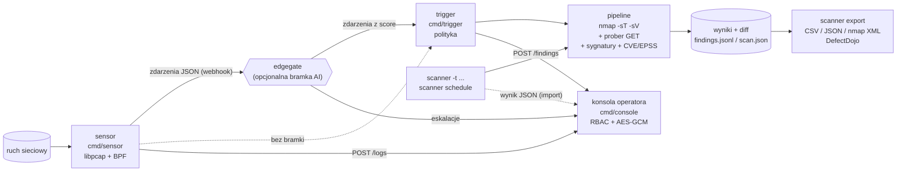

# Silence on the Wire — dokumentacja techniczna

Rozwiązanie na wyzwanie *Attack Surface Intelligence* (Centrum Bezpieczeństwa Informacji AGH, HackNation 2026).

> **Stan dokumentu.** Opisuje gałąź `main` po scaleniu PR #1–#28 (stan z 2026-11-22). Zgodność z treścią zadania wiersz po wierszu, z dowodami w kodzie: [`COMPLIANCE.md`](COMPLIANCE.md). Każdy wiersz mapy wymagań
> (sekcja 9) zweryfikowano w kodzie albo uruchomieniem. Liczby (czasy, progi, domyślne wartości) pochodzą z kodu
> albo z pomiarów wykonanych na tej maszynie; źródło jest podane przy każdej. Luki są opisane wprost w sekcji 10.

## 1. Cel

Duże organizacje skanują sieć okresowo, a między skanami zespół bezpieczeństwa jest ślepy. Host potrafi być widoczny
tylko o określonej porze, a jednorazowy skan nie pokazuje pełnej powierzchni ataku. Projekt łączy dwie perspektywy:

- **pasywny sensor** widzi ruch w sieci cały czas i zgłasza zmiany (nowy host, nowa usługa, zmieniony baner, usługa
  zamilkła lub się zamknęła),
- **aktywny skaner** (nmap + sondy HTTP + sygnatury) odpowiada na pytanie „co tam faktycznie działa”, a **trigger**
  uruchamia go celowo, tylko tam, gdzie sensor zauważył zmianę, zamiast czekać na następny pełny przegląd,
- **konsola operatora** zbiera wyniki, pozwala je importować i edytować (zmiany przeżywają kolejne skany), rozdziela
  uprawnienia rolami i szyfruje dane w spoczynku.

Wyniki dwóch przebiegów można porównać (`scanner diff`, a w konsoli diff przy imporcie skanu), wyeksportować do CSV,
JSON, nmap XML i DefectDojo.

## 2. Architektura



Ta sama w ASCII:

```
ruch ─► [sensor] ──webhook──► [edgegate]* ──► [trigger] ──► [pipeline: nmap + prober + sygnatury + CVE]
          baseline              ocena AI       debounce,         │
          host/port/baner       (score)        cooldown,         ▼
             │                    │            quiet,       findings.jsonl / scan.json ──► scanner export
             │ POST /logs         │            rate limit        │   (CSV|JSON|nmap|DefectDojo)
             ▼                    ▼ eskalacje                    │ POST /findings
        [konsola operatora: alerty, mapa, ekspozycja, TLS, zasoby, ryzyko, cele i import, role]
        ▲                                                        │
        └──────────── import skanu / listy celów (CSV, JSON) ◄───┘  ręczny skan: scanner -t / scanner schedule
* opcjonalna (w demo online wyłączona)
```

Trzy tryby pracy tego samego potoku (`internal/pipeline`):

1. **Ręczny**: `scanner -t <cele> -o scan.json`, potem `scanner diff stary.json nowy.json`.
2. **Harmonogram**: `scanner schedule -window … -every …` (okna czasowe, wznawianie, adaptacyjne paczki).
3. **Sterowany zdarzeniami**: sensor → (edgegate) → trigger → ten sam pipeline; wynik jako *finding* z werdyktem
   i różnicą względem poprzedniego skanu tego celu, wysyłany do konsoli (`POST /findings`).

## 3. Komponenty i pakiety

| Komponent | Ścieżka | Rola |
|---|---|---|
| Sensor | `cmd/sensor`, `internal/sensor` | przechwytuje pakiety (libpcap, filtr BPF w jądrze: ARP, SYN/RST, nagłówki odpowiedzi HTTP), buduje baseline hostów/usług/banerów, zapisuje go na dysk, wysyła zdarzenia JSON-lines i webhookiem |
| Bramka edgegate | `cmd/edgegate`, `internal/edge/aiml` | opcjonalna ocena zdarzeń kaskadą modeli; przekazuje ciekawe z polem `score`, zdarzenia o ciszy/zamknięciu przepuszcza zawsze. Wagi modeli (~2,5 GB) pobierane i weryfikowane SHA256, nie są w repozytorium |
| Trigger | `cmd/trigger`, `internal/trigger` | zamienia zdarzenia na zlecenia skanu; polityka (allowlista, debounce, cooldown, quiet, limit tempa) jest czysta i testowalna; wyniki wysyła do konsoli (`-findings-url`, `-findings-token`) |
| Skaner | `cmd/scanner`, `internal/scan` | cele (IP, CIDR do /12, nazwy), adaptacyjne paczki (`-chunk-time`), równoległe procesy nmap, tryby wykrywania wersji (`-version-mode`), pomiar czasu paczek i całości |
| Harmonogram | `cmd/scanner/schedule.go`, `internal/schedule` | okna czasowe (`-window`), częstotliwość (`-every`), strefa (`-tz`), punkt kontrolny i wznawianie (`-checkpoint`); zamknięcie okna zatrzymuje nmap, następne okno kontynuuje |
| Prober HTTP/TLS | `internal/probe` | wyłącznie GET: status, tytuł, nagłówki, ciasteczka (nazwy i flagi), przekierowania w obrębie hosta, certyfikat TLS, favicon (hash mmh3 jak w Shodan) |
| Sygnatury | `internal/fingerprint`, `internal/fingerprint/signatures/*.yaml` | rozpoznawanie technologii z wagami i confidence; własne sygnatury przez `-signatures plik.yaml` |
| Importer sygnatur | `cmd/sigimport`, `internal/sigimport` | tłumaczy technologie Wappalyzer i szablony nuclei (w tym hashe favicon) na nasz YAML; nie przejmuje ich silników |
| CVE/EPSS | `internal/vuln`, `cmd/scanner/cve.go` | z wykrytej wersji produktu (`-cve`) wylicza CPE, pyta NVD, szereguje CVE wg EPSS (FIRST) i oznacza listę CISA KEV; cache na dysku, brak sieci = brak wzbogacenia |
| Pipeline | `internal/pipeline` | nmap → prober → sygnatury |
| Diff | `internal/diff` | porównanie dwóch skanów: nowe, znikające i zmienione hosty i usługi |
| Eksport | `internal/export`, `internal/export/defectdojo` | CSV, JSON, nmap XML, DefectDojo (obserwacje jako findingi informacyjne) |
| Model wyników | `internal/result` | wspólny model `Scan`/`Host`/`Service`/`Tech`; jeden skan = jeden dokument JSON |
| Konsola | `cmd/console` | panel operatora: logowanie, role (RBAC), alerty/eskalacje, flota sensorów, mapa powierzchni ataku, ekspozycja zewnętrzna, monitor TLS, inwentarz zasobów, ranking ryzyka, cele i import, nadpisania użytkownika, reguły, audyt |
| Szyfrowanie | `internal/atrest`, `cmd/console/crypt.go` | AES-256-GCM dla trwałych plików konsoli |
| Klasyfikacja urządzeń | `internal/classify` | pasywnie z OUI adresu MAC, portów, banerów i certyfikatów, a po imporcie skanu także z produktów i tytułów HTTP: 16 klas (drukarka, kamera, iot, serwer, stacja, sieciowe, telefon, kontener, brama, baza, broker, git, web, cache, pliki, nieznane) |
| Monitor TLS | `internal/tlspolicy`, `cmd/console/tls.go` | wygasanie certyfikatu 30/14/7 dni, wygasły, self-signed, zmiana CA, słaba kryptografia |
| Ekspozycja | `internal/exposure`, `cmd/console/exposure.go` | korelacja widoku od środka (sensor) z widokiem z internetu (Shodan, Censys) |
| Ranking ryzyka | `internal/riskscore`, `cmd/console/risk.go` | wynik 0–100 na host z jawnym rozbiciem na czynniki |
| Generator ruchu | `cmd/traffic`, `internal/traffic` | łagodny ruch w laboratorium, żeby sensor miał co obserwować |
| Laboratorium | `lab/`, `lab/agh/` | własny lab (`lab/docker-compose.yml`) i nakładka na szablony CBI AGH |
| Wdrożenie demo | `deploy/demo/` | publiczne demo: konsola za Cloudflare Tunnel i Access, opcjonalnie lab AGH z sensorem i triggerem na tej samej VM |

Sensor i trigger rozmawiają webhookiem (`POST /events`), opcjonalnie z tokenem `SOTW_WEBHOOK_TOKEN`. Trigger wystawia
`GET /healthz` (zlecenia oczekujące/w toku i powody odrzuceń zdarzeń). Konsola przyjmuje od sensora `POST /logs`, od
bramki AI eskalacje `POST /events`, od triggera `POST /findings` (wszystko z tokenem `ASI_CENTRAL_TOKEN`, bez niego 401).

## 4. Formaty danych

**Wynik skanu** (`scanner -o scan.json`, `internal/result/result.go`): `started_at`, `finished_at`, `duration`,
`targets`, `settings` (argumenty nmap, rozmiar paczki, równoległość: wynik jest odtwarzalny), `chunks[]`
(indeks, liczba celów, `hosts_up`, `duration`, `error`), `hosts[]` z `state`, `services[]`
(port, proto, state, name, product, version, CPE, `http`, `tech[]`) i `extra_ports`.

**Technologia** (`tech[]`): nazwa, kategoria, tagi, `confidence` 0–1, lista dowodów, opcjonalnie wersja i lista CVE
z `-cve` (do pięciu pozycji na technologię, np. „CVE-… — CVSS, EPSS, KEV”).

**Zdarzenie sensora** (JSON lines / webhook): `time`, `type`, `ip`, `port`, `proto`, `old`, `new`, `banner`,
`source` (`passive`), `sensor`; po bramce także `score` i `reason`. Typy: `host_new`, `service_new`,
`service_changed`, `service_closed`, `host_silent`, `service_silent`, `host_back`, `service_back`.

**Finding triggera** (`<state>/findings.jsonl`): cel, rodzaj zlecenia (`scan-service`, `scan-host`, `verify-service`,
`verify-host`), werdykt, zdarzenia, które go wywołały, usługi i technologie oraz zmiany względem poprzedniego skanu
tego celu. Konsola koreluje finding z otwartą sprawą tego hosta (werdykt, usługi i diff jako notatka w audycie) albo
otwiera nową; w logu na żywo ma etykietę `WERYFIKACJA`.

**Import do konsoli** (`POST /api/import?kind=targets|scan`): listy celów w TXT, CSV lub JSON (tablica albo
`{"targets": [...]}`), wynik skanu w JSON (model `internal/result`) albo CSV (z `scanner export`). Limit pliku
5 MiB; zduplikowane cele są pomijane, błędne wpisy zwracane z numerem pozycji.

**Nadpisania użytkownika** (`/api/overrides/{key}`): tytuł, technologia, tagi, notatka, status; przechowywane osobno
od danych skanu i nakładane przy odczycie. Nowy skan lub import podmienia dane skanu, nigdy nadpisań.

**Wyjścia**: `scanner export` → CSV (jeden wiersz na otwartą usługę lub na finding), JSON, nmap XML, DefectDojo.
Kolumny CSV: `address, hostnames, port, proto, service, product, version, http_status, http_title, http_server,
tls_subject, tls_issuer, tls_not_after, tls_self_signed, technologies, tags, confidence, max_confidence`.

**Sygnatura** (YAML, `internal/fingerprint`): `name`, `category`, `tags`, `min_confidence` (domyślnie 0,5)
oraz lista `match`; każdy matcher ma jeden rodzaj dowodu (`header`, `cookie`, `title`, `body`, `favicon`,
`nmap_product`, `nmap_service` lub `path`) i `weight` (domyślnie 0,6). Pliki ze złymi polami są odrzucane
(`KnownFields`). Wbudowanych jest 38 sygnatur (5 plików: apps 11, servers 10, services 8, environment 5, iot 4;
liczone `grep '^- name:'`); importer (`cmd/sigimport`) według README daje na obecnych źródłach około 60 000
dodatkowych, których nie ma w repozytorium (generowany plik jest danymi, nie kodem).

## 5. Model bezpieczeństwa

### 5.1. Skaner

Moduł sygnatur wykrywa **obecność** cech, nie eksploatuje podatności. Zasady wynikające z kodu:

| Zasada | Gdzie w kodzie |
|---|---|
| Prober wysyła tylko GET, nigdy nie loguje się, przekierowania tylko w obrębie tego samego hosta (maks. 5), ograniczony rozmiar treści (512 KiB) i favicony (256 KiB), limit czasu na żądanie (domyślnie 10 s) | `internal/probe/probe.go` |
| Brak skryptów NSE i wykrywania OS; domyślnie skan connect `-sT`, `-sS` tylko jawnie (wymaga `CAP_NET_RAW`) | `internal/scan/nmap.go`, flaga `-sS` |
| Limit tempa nmap: `-max-rate` domyślnie 300 pakietów/s na proces, `--host-timeout` domyślnie 5 min | `cmd/scanner` |
| Łączne obciążenie ograniczone: `-parallel` (domyślnie 4 procesy) × `-max-rate` | `internal/scan/scanner.go` |
| Allowlista: `-allow` w skanerze odrzuca cele spoza zakresów; w triggerze `-allow` jest **wymagane** | `cmd/scanner`, `cmd/trigger` |
| Ścieżki z sygnatur to stałe adresy (np. `/wp-login.php`); wyłączane przez `-fingerprint-paths=false`, sondy całe przez `-probe=false` | `internal/fingerprint`, `cmd/scanner` |
| CIDR rozwijany maksymalnie do 2^20 adresów (/12), większe zakresy to błąd | `internal/scan/targets.go` |
| Trigger: debounce 5 s, quiet 15 s po skanie adresu, cooldown 60 s na cel (5 min, gdy były tylko zdarzenia „closed”), maks. 10 skanów/min, maks. 1000 oczekujących zleceń, 2 skany równolegle, limit czasu skanu 5 min | `internal/trigger/policy.go`, `cmd/trigger/main.go` |
| Trigger ignoruje zdarzenia o własnych adresach skanera (`-ignore-self`) i o sieciach z `-ignore-net` | `cmd/trigger/main.go` |
| Po werdykcie „żyje” kolejne zdarzenia „zamilkł” o tym celu są ignorowane przez 30 min (`VerifyBackoff`) | `internal/trigger/policy.go` |
| Okna czasowe harmonogramu: poza oknem skan nie startuje, a zamknięcie okna zatrzymuje nmap | `internal/schedule` |
| Zapytania CVE/EPSS idą do NVD i FIRST, nie do skanowanych hostów; bez wersji produktu nie ma zapytania | `internal/vuln` |
| Obrazy Docker działają jako użytkownik bez uprawnień; sensor ma tylko `CAP_NET_RAW`, skaner i trigger żadnych | `Dockerfile`, nakładka `lab/agh` (`cap_drop: [ALL]`) |
| Webhook chroniony tokenem bearer (`SOTW_WEBHOOK_TOKEN`, `ASI_CENTRAL_TOKEN`) | `cmd/sensor`, `cmd/trigger`, `cmd/console` |

### 5.2. Role i uprawnienia (RBAC)

Endpointy wymagają **uprawnień** (np. `targets:write`), nie nazw ról, więc własne role działają bez zmian w
handlerach (`cmd/console/rbac.go`). Wbudowane role (niezmienne):

| Rola | Etykieta | Zakres |
|---|---|---|
| `admin` | Administracja | wszystkie uprawnienia, w tym użytkownicy, role, ustawienia, audyt |
| `editor` | Edytor | dodawanie, usuwanie i modyfikacja: sprawy (tworzenie, usuwanie), reguły, cele i import, skany kontrolne, ekspozycja, TLS na żądanie |
| `analyst` | Analityk | modyfikacja i odczyt: odczyt wszystkiego z listy poniżej plus zmiana spraw i nadpisań; domyślna rola nowego konta |
| `viewer` | Podgląd | tylko odczyt: sprawy, sensory, logi, reguły, cele/inwentarz/nadpisania, TLS, zasoby, ranking ryzyka |

Własne role tworzy administrator (`POST /api/roles`, edytor ról w zakładce „Role”) z katalogu 22 uprawnień
(`cases:*`, `sensors:read`, `logs:read`, `rules:*`, `config:*`, `groundtruth:run`, `exposure:run`, `users:manage`,
`roles:manage`, `audit:read`, `targets:*`, `overrides:write`, `tls:*`, `assets:read`, `risk:read`). Zmiany ról, użytkowników
i spraw trafiają do dziennika audytu (`/api/audit`, uprawnienie `audit:read`). Zweryfikowano lokalnie (konsola w trybie
demo, konto `jury` z rolą `viewer`): odczyt zakładek zwraca 200; `GET /api/config`, `/api/users`, `/api/roles`, `/api/audit`
zwracają 403; `POST` na `/api/exposure/run`, `/api/tls/run`, `/api/groundtruth/run`, `/api/targets`, `/api/import` i `PUT
/api/overrides/…` zwracają 403. Zakładki „Ustawienia” i „Role” nie są dla `viewer` widoczne, ale przycisk „Edytuj” w
„Cele i import” jest widoczny; serwer i tak odrzuca zapis (403).

Hasła: PBKDF2-HMAC-SHA256 (120 000 iteracji, sól na użytkownika). Sesje: losowe tokeny w pamięci (TTL 12 h),
ciasteczko `HttpOnly`, `SameSite=Lax`. Samorejestracja da się wyłączyć (`ASI_ALLOW_REGISTRATION=false`; wdrożenie demo
tak robi), konta wdrożeniowe powstają z `ASI_ADMIN_LOGIN` i `ASI_VIEWER_LOGIN` (hasła z plików, nigdy z repozytorium).

### 5.3. Szyfrowanie w spoczynku

`internal/atrest`: AES-256-GCM, plik poprzedza nagłówek `ASIE\x01`, nonce losowy, nazwa pliku jest danymi
uwierzytelnianymi (blob nie da się podmienić między plikami). Szyfrowane są trwałe pliki konsoli: konta, role,
ustawienia (w tym klucze API), reguły, sprawy, rejestr hostów (ground truth), inwentarz (`state.json`, `scan.json`),
monitor TLS, stan ekspozycji i dziennik audytu. Zweryfikowano: po imporcie skanu plik `inventory/scan.json` i `users.json` zaczynają się od
bajtów `ASIE`. Klucz: `ASI_DATA_KEY` (32 bajty, hex/base64), albo plik `ASI_DATA_KEY_FILE`, albo `<data-dir>/data.key` tworzony przy pierwszym
starcie (0600). Stare pliki jawne są czytelne i szyfrowane przy następnym zapisie. Utrata klucza = nieczytelne dane. Na
produkcji klucz powinien leżeć poza woluminem danych (w demo: `secrets/data_key`).

Poza szyfrowaniem: wyniki skanów zapisywane przez sam skaner (`scan.json`, `findings.jsonl` triggera) są zwykłymi plikami
(0600), nie przechodzą przez `atrest`; szyfrowana jest ich kopia w konsoli.

## 6. Odpowiedzi na pytania z zadania

### 6.1. Jak raportować zmianę?

Trzy uzupełniające się mechanizmy:

- **Pasywnie, w czasie rzeczywistym** (sensor): zdarzenie na każdą zmianę stanu. Baner porównywany jest przez
  odcisk (`Server`, `X-Powered-By`, `X-Env` …); pierwszy baner dla znanego portu to wzbogacenie, nie zmiana
  (`internal/sensor/tracker.go`). Wszystko w oknie uczenia (`-learn`) trafia do baseline’u po cichu.
- **Aktywnie, między przebiegami** (`scanner diff`, diff przy imporcie w konsoli): hosty i usługi **nowe** (`+`),
  **znikające** (`-`) i **zmienione** (`~`: produkt, wersja, tytuł, nagłówki, certyfikat, technologie). Dane zmienne z
  natury (daty, ETag, hashe treści) są pomijane. Host z poprzedniego skanu, którego nowy skan nie miał w celach, jest „nie
  skanowany”, nie „zniknął”. Różnica w argumentach nmap daje ostrzeżenie, że zmiana może pochodzić z ustawień, nie z sieci.
  `scanner diff` ma flagi `-json` i `-exit-code`.
- **W czasie** (konsola): mapa powierzchni ataku odtwarza dziennik topologii (pojawienie się, cisza, werdykty skanów
  kontrolnych) suwakiem czasu; TLS i ekspozycja zgłaszają zmiany jako sprawy.

Trigger dołącza do findingu zmiany względem poprzedniego skanu tego celu (`changes: +1 -0 ~0 services`).

### 6.2. Jak liczyć pewność (confidence) identyfikacji technologii?

`internal/fingerprint`: każdy pasujący matcher (dowód) ma wagę `w` w (0, 1], domyślnie 0,6. Pewność to **noisy-OR**:

```
confidence = 1 − Π (1 − w_i)     po wszystkich dopasowanych dowodach
```

Kilka niezależnych słabych dowodów daje wysoką pewność, a pojedynczy słaby zostaje niski. Technologia jest
zgłaszana, gdy `confidence ≥ min_confidence` sygnatury (domyślnie 0,5); wynik zaokrąglany do 2 miejsc, lista sortowana
malejąco. Wersja pochodzi z dowodu o największej wadze, który ją podaje. Przykłady zmierzone na laboratorium AGH
(`scanner export`, kolumna `confidence`): Gitea 0,99, RabbitMQ Management 0,95, strona domyślna nginx 0,90,
„Admin panel” 0,60. W DefectDojo pewność trafia do opisu findingu, a `-min-confidence` odrzuca słabe obserwacje.
Osobno ranking ryzyka hosta (`internal/riskscore`) łączy sygnały w wynik 0–100 z jawnymi punktami (CVE/EPSS do 33,
ocena kaskady modeli do 20, porty administracyjne do 18, nowe usługi do 12 i inne, każdy składnik z limitem);
progi poziomów: 70+ krytyczne, 40+ wysokie, 15+ średnie.

### 6.3. Po jakim czasie braku odpowiedzi raportować host jako nieaktywny?

Brak pojedynczej odpowiedzi to za mało: host niestabilny albo wyłączany na noc nie jest „zniknięty”. Kod stosuje
**trzy stopnie** i dopiero ostatni jest werdyktem:

1. **Podejrzenie (pasywnie):** `internal/sensor/tracker.go`, `Sweep`: host lub usługa dostaje stan `silent`
   i zdarzenie `host_silent`/`service_silent`, gdy od ostatniego pakietu minęło więcej niż `-silent-after`
   (**domyślnie 2 min**; nakładka AGH ustawia 60 s, `SENSOR_SILENT_AFTER`). Przegląd co `-sweep`
   (**10 s**), więc realne opóźnienie to próg + do 10 s. Okres liczony jest od `max(LastSeen, start)`, więc po
   restarcie z wczytanym baseline’em jest okres karencji. Adresy spoza obserwowanego zakresu nigdy nie dostają „silent”.
   Usługa po RST (`service_closed`) to twardszy dowód niż cisza: host żyje, port zamknięty.
2. **Weryfikacja (aktywnie):** zdarzenie „silent” uruchamia `verify-host` (lub `verify-service`): skan top-100 portów
   (`-top-ports 100`). Werdykt `still-up`, jeśli host odpowiedział na jakimkolwiek porcie (otwartym albo zamkniętym
   RST), `down-confirmed`, gdy **wszystkie** próby przekroczyły czas. Dla usługi: `still-open` albo `gone-confirmed`.
3. **Histereza:** po werdykcie „żyje” kolejne zdarzenia „zamilkł” są ignorowane **30 min**, bo skan sam
   „budzi” hosta w oczach sensora i bez tego host, z którym nikt nie rozmawia, byłby weryfikowany w nieskończoność.
   Cooldown między skanami jednego celu to 60 s (5 min dla samych zdarzeń „closed”).

Dodatkowo konsola ma „ground truth”: co `gt_interval_min` (domyślnie 360 min = 6 h) sonduje próbkę (domyślnie 50) hostów,
które milczą co najmniej `gt_silent_min` (domyślnie 60 min) łączeniami TCP (porty z `defaultProbePorts`: 22, 80, 443, 445, 3306,
3389, 5432, 6379, 8080, 8443, 9200, plus znane z sensora), żeby odróżnić „cichy” od „wyłączony”.

**Wniosek praktyczny:** „nieaktywny” = cisza ponad próg sensora **i** potwierdzenie aktywną sondą (`down-confirmed`).
W trybie okresowym `scanner diff` oznacza hosta jako zniknął już po **jednym** przebiegu bez odpowiedzi; reguły
„N kolejnych przebiegów” między skanami **w kodzie nie ma** (luka, sekcja 10). Dla hostów, które odpowiadają tylko o
określonej porze, zalecane jest dobranie `-silent-after` do okna i porównywanie skanów z tej samej pory (`scanner schedule`
ustawia stałe okno i częstotliwość).

## 7. Uruchomienie

Wymagania: Go 1.26+, `nmap`, `libpcap-dev` (sensor), Docker (laboratorium).

```bash
make build                      # bin/sensor, scanner, trigger, traffic, edgegate
make console                    # bin/console
make test                       # go vet + go test (potrzebuje libpcap-dev)
make images                     # lokalne obrazy sensor/scanner/trigger/traffic pod nazwami z rejestru (obraz console buduje CI)
```

Skan ręczny, porównanie, eksport:

```bash
./bin/scanner -t 10.0.0.0/24 -p 22,80,443,8000-8100 -o scan1.json
./bin/scanner -t 10.0.0.0/24 -p 22,80,443,8000-8100 -cve -o scan2.json     # -cve: wzbogacenie CVE/EPSS
./bin/scanner diff scan1.json scan2.json
./bin/scanner export -o scan.csv scan2.json
./bin/scanner export -format defectdojo -dry-run scan2.json
```

Harmonogram (CLI; nie jest wpięty w UI konsoli):

```bash
./bin/scanner schedule -window 22:00-05:00 -tz Europe/Warsaw -every daily@22:00 \
  -checkpoint state.jsonl -out results -f targets.txt -allow 10.0.0.0/16
```

Konsola lokalnie w trybie demo (dane syntetyczne: 137 sensorów, 217 spraw; konta z zmiennych środowiskowych):

```bash
ASI_CENTRAL_TOKEN=<token> ASI_ADMIN_LOGIN=admin ASI_ADMIN_PASSWORD=<hasło> \
ASI_VIEWER_LOGIN=jury ASI_VIEWER_PASSWORD=<hasło> ASI_ALLOW_REGISTRATION=false \
./bin/console -demo -listen 127.0.0.1:18081 -data-dir var/console
```

Laboratorium CBI AGH z nakładką (szablony CBI AGH w `lab/agh/upstream/` bez zmian):

```bash
docker compose -f lab/agh/upstream/docker-compose-custom-network.yml \
               -f lab/agh/traffic-custom-network.yml up -d
lab/agh/scenario.sh          # scenariusz: zmiana bannera, stop/start usługi, nowy host, flapper
```

Nakładka dodaje: `traffic` (ruch w tle), `flapper` (nginx up/down co `FLAP_UP`/`FLAP_DOWN`, domyślnie 60/60 s),
`sensor` (`-i 'br-*'`, `-learn 30s`, `-silent-after 60s`, tylko `CAP_NET_RAW`) i `trigger` (`-allow 172.16.0.0/12`,
`127.0.0.1:8099`). Własne małe laboratorium: `make lab-up` (`lab/docker-compose.yml`, mostek `br-asilab`, `172.28.0.0/24`).

**Publiczne demo** (`deploy/demo/`, opis w `deploy/demo/README.md`): <https://silent.zjadlabymciastko.net>. Jedna VM
(Proxmox), jeden projekt compose; konsola w trybie demo+live (syntetyczna flota plus prawdziwe zdarzenia), dostępna wyłącznie
przez Cloudflare Tunnel za Cloudflare Access (jednorazowy PIN na e-mail); na hoście nie jest publikowany żaden port. Na tej
samej VM działa lab AGH z sensorem i triggerem (profil `lab`); aktualizacja przez `docker compose pull` co 5 min
(timer systemd), obrazy z CI. Konta: `admin` (administracja) i `jury` (rola `viewer`, tylko odczyt); hasła w
`secrets/`, nie w repozytorium. Klucze Shodan/Censys/NVD są opcjonalne i czytane tylko ze zmiennych środowiskowych.
Scenariusz pokazu krok po kroku: [`DEMO.md`](DEMO.md).

## 8. Zmierzone wartości (ta maszyna, 2026-11-22)

Nie są to benchmarki wydajności, tylko odnotowane przebiegi pokazowe.

| Co | Wynik | Skąd |
|---|---|---|
| Skan 7 portów na `127.0.0.1` (`-sT -sV -Pn`, jeden chunk, wersja skanera sprzed #14) | 48,0 s | log skanera; dominuje `-sV` na portach 5673 i 15432 |
| Sonda HTTP 4 usług | 8 ms | log skanera |
| Fingerprinting | 12 ms | log skanera |
| Różnica skan 1 → skan 2 po uruchomieniu nginx | `+ 18787/tcp http nginx 1.31.9`, 1 nowa usługa | `scanner diff` oraz import w konsoli |
| Skan 2 → skan 3 po zatrzymaniu nginx | `- 18787/tcp http nginx 1.31.9`, 1 znikająca | `scanner diff` oraz import w konsoli |
| Edycja wpisu w konsoli, potem ponowny import skanu | nadpisanie (tytuł, tagi, notatka, status) zostaje | `PUT /api/overrides/…`, `GET /api/inventory` |
| Konsola `-demo`: dane startowe | 137 sensorów, 217 spraw | log konsoli |

Czas skanu z `-version-mode balanced` i `-chunk-time` (zmiany z #14) na tej maszynie nie był ponownie mierzony.

## 9. Mapa wymagań z treści zadania

Legenda: **zrobione** = jest w `main` i sprawdzone w kodzie lub uruchomieniem; **częściowo** = działa z zastrzeżeniem
opisanym w kolumnie; **brak** = nie ma w `main`.

| # | Wymaganie | Realizacja | Status |
|---|---|---|---|
| 1 | Wczytanie listy IP, CIDR, domen | CLI `-t` i `-f plik`; w konsoli formularz „Dodaj cel ręcznie” i import pliku (TXT/CSV/JSON); CIDR do /12, nazwy hostów walidowane | zrobione |
| 2a | Wielowątkowy skan nmap | paczki, `-parallel` (domyślnie 4) procesów nmap | zrobione |
| 2b | Czas trwania skanu | `duration` skanu i każdej paczki w wyniku i w logu; harmonogram loguje przewidywany koniec | zrobione |
| 2c | Podział adresów na podgrupy | adaptacyjny rozmiar paczki wg zmierzonego tempa (`-chunk-time`, domyślnie 1 min), albo stały `-chunk` | zrobione |
| 3 | Wykrycie aktywnych hostów | stan `up` z nmap, `-Pn`, `Responded()` (otwarty lub zamknięty port) | zrobione |
| 4 | Identyfikacja podstawowych usług | `nmap -sV` (tryby `balanced`/`fast`/`full`), CPE | zrobione |
| 5 | HTTP/HTTPS: tytuł, kod, nagłówki, ciasteczka, TLS, przekierowania | `internal/probe` | zrobione |
| 6 | Wykrywanie technologii (CMS, framework, serwer, IoT) | 38 wbudowanych sygnatur z confidence; importer Wappalyzer/nuclei | zrobione |
| 7 | Staging, panel administracyjny | tagi `staging`, `admin-panel`, `setup-page`, `default-page` | zrobione |
| 8 | Porównanie wyników między przebiegami | `scanner diff` (`-json`, `-exit-code`); diff przy imporcie skanu w konsoli | zrobione |
| 9 | Oznaczenie nowych, znikających, zmienionych | `+` / `-` / `~` w diffie; zdarzenia sensora | zrobione |
| 10 | Własne sygnatury | `-signatures plik.yaml` (w skanerze i w triggerze); `cmd/sigimport` | zrobione; nie ma edytora sygnatur w UI konsoli |
| 11 | Formularz wprowadzania danych (ręcznie, CSV/JSON), przetwarzany tak samo | zakładka „Cele i import”: dodanie celu, import listy celów, import wyniku skanu; wszystko trafia do tego samego inwentarza z diffem | zrobione; konsola **nie uruchamia skanu** wpisanych celów, skan wykonuje się z CLI lub harmonogramu (sekcja 10) |
| 12 | RBAC z różnymi rolami | uprawnienia + role wbudowane i własne (sekcja 5.2) | zrobione |
| 13 | Role: administracja; dodawanie/usuwanie/modyfikacja; modyfikacja i odczyt; odczyt | `admin`, `editor`, `analyst`, `viewer` | zrobione |
| 14 | Edycja wprowadzonych wartości, zachowanie przy kolejnych skanach | nadpisania użytkownika (tytuł, technologia, tagi, notatka, status), zachowane po ponownym imporcie (sprawdzone) | zrobione |
| 15 | Czytelny interfejs, dashboard najważniejszych znalezisk | konsola: Alerty (liczniki, karty), Mapa, Ekspozycja, TLS, Zasoby, Ryzyko (top N), Logi live, Sensory, Cele i import | zrobione; wiele widoków w demo pokazuje dane syntetyczne albo puste stany bez żywego sensora |
| 16 | Szyfrowanie w spoczynku wrażliwych pól | AES-256-GCM dla trwałych plików konsoli (sekcja 5.3) | zrobione dla konsoli; pliki wyjściowe CLI nie są szyfrowane |
| M1 | Import listy hostów/zakresów | jak 1 | zrobione |
| M2 | Import wyników skanów JSON/CSV | `POST /api/import?kind=scan` (JSON modelu wyników, CSV z `scanner export`) | zrobione |
| M3 | Duże zakresy >10 000 IP | rozwijanie do 2^20 adresów, paczki adaptacyjne, równoległość; nie testowano na 10 000 adresów | zrobione w kodzie, **nie zmierzone** |
| M4 | Okno czasowe i częstotliwość uruchamiania | `scanner schedule` (okna, `-every`, strefa, wznawianie) | zrobione w CLI; **nie wpięte w UI konsoli** |
| M5 | Ograniczanie tempa zapytań | `-max-rate`, `-parallel`; w triggerze limit/min, cooldown | zrobione |
| M6 | Wykrywanie aktywnych hostów, identyfikacja usług | jak 3–4 | zrobione |
| M7 | Zapis wyników do bazy lub pliku | JSON (`scan.json`, `findings.jsonl`), w konsoli pliki szyfrowane | zrobione (pliki, bez bazy SQL) |
| M8 | Porównanie dwóch skanów | jak 8 | zrobione |
| M9 | Dashboard/raport zmian | konsola (Mapa, Cele i import: „Ostatni diff”, Ryzyko) i `scanner diff` | zrobione |
| M10 | Eksport JSON/CSV | `scanner export -format csv\|json\|nmap` | zrobione (CLI; konsola nie ma przycisku eksportu wyników; lista celów: `GET /api/targets.txt`) |
| M11 | Role, edycja, szyfrowanie | jak 12–16 | zrobione |
| D1 | Harmonogram cyklicznych skanów | `scanner schedule` | zrobione w CLI; brak w UI |
| D2 | Różnice zależne od pory dnia | okna harmonogramu pozwalają skanować o stałej porze; osobnej analizy „ta sama godzina, różne dni” nie ma | brak (częściowo: dane czasowe sensora i mapa) |
| D3 | Ocena ciekawości/priorytetu | ranking ryzyka 0–100 z rozbiciem na czynniki; `score` z bramki AI; CVE/EPSS/KEV | zrobione |
| D4 | Powtarzanie pomiarów dla hostów niestabilnych | werdykty `verify-*`, cooldown, `VerifyBackoff` w triggerze; skany kontrolne ground truth; flapper w labie | zrobione (weryfikacja zdarzeniowa) |
| D5 | Fingerprinting HTTP/HTTPS | jak 5 | zrobione |
| D6 | Proste wykrywanie CMS/technologii | jak 6 | zrobione |
| D7 | Grupowanie podobnych usług | kategorie i tagi sygnatur, selektory eksportu `category:`, `tag:`, `tech:`; klasy urządzeń w zasobach | zrobione (częściowo) |
| D8 | Tagi | tagi sygnatur, tagi użytkownika w nadpisaniach, tagi findingów w DefectDojo | zrobione |
| D9 | Eksport do DefectDojo jako finding informacyjny | `scanner export -format defectdojo`, stabilny `unique_id_from_tool` (zweryfikowane `-dry-run`) | zrobione; wysyłka do żywej instancji nie testowana w tej dokumentacji |
| D10 | Wizualizacja zmian w czasie | mapa powierzchni ataku z osią czasu (odtwarzanie dziennika topologii) | zrobione; na demo wymaga żywego sensora (bez niego „Mapa jest jeszcze pusta”) |
| D11 | Integracja z pasywnymi źródłami | własny sensor pasywny; zasoby klasyfikowane z ruchu; ekspozycja Shodan/Censys | zrobione; Shodan/Censys wymagają kluczy, bez nich zakładka mówi „nie jest skonfigurowana” |
| + | Monitor TLS | wygasanie 30/14/7 dni, self-signed, zmiana CA, słaba kryptografia; sprawdzanie co godzinę (domyślnie) | zrobione; w demo bez celów TLS jest pusty |

Kryteria testowe z sekcji 6 zadania pokrywają odpowiednio: hosty niestabilne (6.3 i flapper w `lab/agh`),
bezpieczeństwo skanera (sekcja 5.1), role (5.2), import/eksport (sekcje 4 i 7), testy w `internal/*/…_test.go`.

## 10. Znane luki i ograniczenia

- **Błąd interfejsu konsoli naprawiony w #24.** Od scalenia #15 do #24 w `cmd/console/static/index.html` brakowało
  `}` w `importFile()`: przeglądarka zgłaszała `Uncaught SyntaxError: Unexpected end of input`, a strona konsoli
  zostawała pusta (bez ekranu logowania), mimo że API działało. Jeśli publiczne demo nie pokazuje ekranu logowania,
  sprawdź, czy VM pobrała obraz z #24 (aktualizacja co 5 min).
- **Harmonogram jest tylko w CLI** (`scanner schedule`). Konsola go nie wywołuje ani nie pokazuje; nie ma też przycisku
  „uruchom skan” dla celów wpisanych w formularzu (konsola przechowuje cele i wyniki, skanuje je skaner/trigger).
- **Shodan i Censys** bez kluczy API są puste (komunikat „nie jest skonfigurowana”); na publicznym demo klucze są
  opcjonalne i, o ile nie ustawione, widok ekspozycji pozostaje pusty. Kontrole z NVD działają bez klucza, ale wolniej.
- **Bramka AI (edgegate)** jest opcjonalna i w demo online wyłączona (UI konsoli pokazuje „AI: wyłączone”); wagi modeli
  mają ~2,5 GB i nie są w repozytorium. Cel 50% jest skalibrowany na danych syntetycznych, nie jest twardą kwotą.
- **Dane demo.** W trybie `-demo` flota (137 sensorów), sprawy i ranking ryzyka pochodzą z generatora; dopiero prawdziwe
  zdarzenia z sensora (lab AGH) napełniają Mapę i Zasoby. Zasoby z laboratorium Dockera dostają od #28 konkretne klasy (`kontener`, `brama`, `baza`,
  `broker`, `git`, `web`…) z portów, produktów i tytułów HTTP z zaimportowanego skanu; sam OUI w sieci mostowej niczego
  nie rozstrzyga (adresy `02:42:…` to kontenery), więc bez skanu wiele hostów zostaje „nieznanych”.
- **Reguła „N skanów z rzędu”** dla hosta nieaktywnego w trybie okresowym nie jest zaimplementowana (sekcja 6.3).
- **Wyniki** skanera to pliki JSON bez bazy danych; szyfrowane są pliki konsoli, nie wyjście CLI.
- **Skala >10 000 adresów** nie została zmierzona.
- **Różnice zależne od pory dnia**: brak dedykowanej analizy.
- Konsola nie ma przycisku eksportu wyników skanu do CSV/JSON/DefectDojo; eksport robi `scanner export` z wynikiem skanu.
