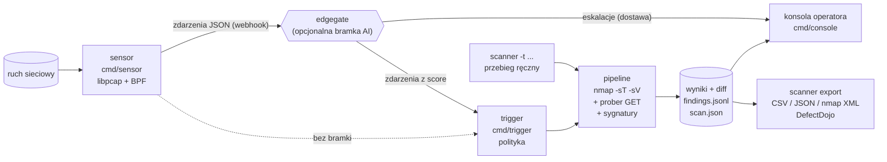

# Silence on the Wire — dokumentacja techniczna

Rozwiązanie na wyzwanie *Attack Surface Intelligence* (Centrum Bezpieczeństwa Informacji AGH, HackNation 2026).

> **Stan dokumentu.** Opisuje stan gałęzi `main` w chwili pisania. Funkcje, które czekają w otwartych pull requestach
> albo w trakcie prac, są oznaczone **[PR #n]** lub **[w toku]** i nie należy ich uznawać za część `main`.
> Liczby (czasy, progi, domyślne wartości) pochodzą z kodu albo z pomiarów wykonanych na tej maszynie; skąd, jest podane przy każdej.

## 1. Cel

Duże organizacje skanują sieć okresowo, a między skanami zespół bezpieczeństwa jest ślepy. Host potrafi być widoczny
tylko o określonej porze, a jednorazowy skan nie pokazuje pełnej powierzchni ataku. Projekt łączy dwie perspektywy:

- **pasywny sensor** widzi ruch w sieci cały czas i zgłasza zmiany (nowy host, nowa usługa, zmieniony baner, usługa
  zamilkła lub się zamknęła),
- **aktywny skaner** (nmap + sondy HTTP + sygnatury) odpowiada na pytanie „co tam faktycznie działa”, a **trigger**
  uruchamia go celowo, tylko tam, gdzie sensor zauważył zmianę, zamiast czekać na następny pełny przegląd.

Wyniki dwóch przebiegów można porównać (`scanner diff`), wyeksportować do CSV, JSON, nmap XML i DefectDojo.

## 2. Architektura



Ta sama w ASCII:

```
ruch ─► [sensor] ──webhook──► [edgegate]* ──► [trigger] ──► [pipeline: nmap + prober + sygnatury]
          baseline              ocena AI       debounce,         │
          host/port/baner       (score)        cooldown,         ▼
                                  │            quiet,      findings.jsonl / scan.json
                                  │            rate limit        │            │
                                  ▼                              ▼            ▼
                            [konsola operatora]            scanner diff   scanner export
                            (eskalacje, flota)                            CSV|JSON|nmap|DefectDojo
* opcjonalna
```

Dwa tryby pracy tego samego potoku (`internal/pipeline`):

1. **Ręczny/okresowy**: `scanner -t <cele> -o scan.json`, potem `scanner diff stary.json nowy.json`.
2. **Sterowany zdarzeniami**: sensor → (edgegate) → trigger → ten sam pipeline, wynik jako *finding* z werdyktem
   i różnicą względem poprzedniego skanu tego celu.

## 3. Komponenty i pakiety

| Komponent | Ścieżka | Rola |
|---|---|---|
| Sensor | `cmd/sensor`, `internal/sensor` | przechwytuje pakiety (libpcap, filtr BPF w jądrze: ARP, SYN/RST, nagłówki odpowiedzi HTTP), buduje baseline hostów/usług/banerów, zapisuje go na dysk, wysyła zdarzenia JSON-lines i webhookiem |
| Bramka edgegate | `cmd/edgegate`, `internal/edge/aiml` | opcjonalna ocena zdarzeń kaskadą modeli; przekazuje ciekawe z polem `score`, zdarzenia o ciszy/zamknięciu przepuszcza zawsze. Wagi modeli (~2,5 GB, według README) pobierane i weryfikowane SHA256, nie są w repozytorium |
| Trigger | `cmd/trigger`, `internal/trigger` | zamienia zdarzenia na zlecenia skanu; polityka (allowlista, debounce, cooldown, quiet, limit tempa) jest czysta i testowalna |
| Skaner | `cmd/scanner`, `internal/scan` | cele (IP, CIDR do /12, nazwy), podział na chunki, równoległe procesy nmap, pomiar czasu chunków i całości |
| Prober HTTP/TLS | `internal/probe` | wyłącznie GET: status, tytuł, nagłówki, ciasteczka (nazwy i flagi), przekierowania w obrębie hosta, certyfikat TLS, favicon (hash mmh3 jak w Shodan) |
| Sygnatury | `internal/fingerprint`, `internal/fingerprint/signatures/*.yaml` | rozpoznawanie technologii z wagami i confidence; własne sygnatury przez `-signatures plik.yaml` |
| Pipeline | `internal/pipeline` | nmap → prober → sygnatury |
| Diff | `internal/diff` | porównanie dwóch skanów: nowe, znikające i zmienione hosty i usługi |
| Eksport | `internal/export`, `internal/export/defectdojo` | CSV, JSON, nmap XML, DefectDojo (obserwacje jako findingi informacyjne) |
| Model wyników | `internal/result` | wspólny model `Scan`/`Host`/`Service`/`Tech`; jeden skan = jeden dokument JSON |
| Konsola | `cmd/console` | panel operatora: logowanie, eskalacje (przypadki), flota sensorów, reguły, log na żywo, „ground truth” |
| Generator ruchu | `cmd/traffic`, `internal/traffic` | łagodny ruch w laboratorium (GET, połączenia TCP z odczytem bannera), żeby sensor miał co obserwować |
| Laboratorium | `lab/`, `lab/agh/` | własny lab (`lab/docker-compose.yml`) i nakładka na szablony CBI AGH |

Sensor i trigger rozmawiają webhookiem (`POST /events`), opcjonalnie z tokenem `SOTW_WEBHOOK_TOKEN`. Trigger wystawia
też `GET /healthz` (zlecenia oczekujące/w toku i powody odrzuceń zdarzeń).

## 4. Formaty danych

**Wynik skanu** (`scanner -o scan.json`, `internal/result/result.go`): `started_at`, `finished_at`, `duration`,
`targets`, `settings` (argumenty nmap, rozmiar chunka, równoległość: wynik jest odtwarzalny), `chunks[]`
(indeks, liczba celów, `hosts_up`, `duration`, `error`), `hosts[]` z `state`, `services[]`
(port, proto, state, name, product, version, CPE, `http`, `tech[]`) i `extra_ports`.

**Technologia** (`tech[]`): nazwa, kategoria, tagi, `confidence` 0–1, lista dowodów, opcjonalnie wersja.

**Zdarzenie sensora** (JSON lines / webhook): `time`, `type`, `ip`, `port`, `proto`, `old`, `new`, `banner`,
`source` (`passive`), `sensor`; po bramce także `score` i `reason`. Typy: `host_new`, `service_new`,
`service_changed`, `service_closed`, `host_silent`, `service_silent`, `host_back`, `service_back`.

**Finding triggera** (`<state>/findings.jsonl`): cel, rodzaj zlecenia (`scan-service`, `scan-host`, `verify-service`,
`verify-host`), werdykt, zdarzenia, które go wywołały, usługi i technologie oraz zmiany względem poprzedniego skanu
tego celu.

**Wyjścia**: `scanner export` → CSV (jeden wiersz na otwartą usługę lub na finding), JSON, nmap XML, DefectDojo.
Kolumny CSV: `address, hostnames, port, proto, service, product, version, http_status, http_title, http_server,
tls_subject, tls_issuer, tls_not_after, tls_self_signed, technologies, tags, confidence, max_confidence`.

**Sygnatura** (YAML, `internal/fingerprint`): `name`, `category`, `tags`, `min_confidence` (domyślnie 0,5)
oraz lista `match`; każdy matcher ma jeden rodzaj dowodu (`header`, `cookie`, `title`, `body`, `favicon`,
`nmap_product`, `nmap_service` lub `path`) i `weight` (domyślnie 0,6). Pliki ze złymi polami są odrzucane
(`KnownFields`), literówka nie jest po cichu pomijana. Wbudowanych jest 38 sygnatur (5 plików: apps 11, servers 10,
services 8, environment 5, iot 4; liczone `grep '^- name:'`).

## 5. Model bezpieczeństwa skanera

Moduł sygnatur wykrywa **obecność** cech, nie eksploatuje podatności. Zasady wynikające z kodu:

| Zasada | Gdzie w kodzie |
|---|---|
| Prober wysyła tylko GET, nigdy nie loguje się, przekierowania tylko w obrębie tego samego hosta (maks. 5), ograniczony rozmiar treści (512 KiB) i favicony (256 KiB), limit czasu na żądanie (domyślnie 10 s) | `internal/probe/probe.go` |
| Brak skryptów NSE i wykrywania OS; domyślnie skan connect `-sT`, `-sS` tylko jawnie (wymaga `CAP_NET_RAW`) | `internal/scan/nmap.go`, flaga `-sS` |
| Limit tempa nmap: `-max-rate` domyślnie 300 pakietów/s na proces, `--host-timeout` domyślnie 5 min | `cmd/scanner/main.go` |
| Łączne obciążenie ograniczone: `-parallel` (domyślnie 4 procesy) × `-max-rate` | `internal/scan/scanner.go` |
| Allowlista: `-allow` w skanerze odrzuca cele spoza zakresów; w triggerze `-allow` jest **wymagane** | `cmd/scanner`, `cmd/trigger` |
| Ścieżki z sygnatur to stałe adresy (np. `/wp-login.php`); wyłączane przez `-fingerprint-paths=false`, sondy całe przez `-probe=false` | `internal/fingerprint`, `cmd/scanner` |
| CIDR rozwijany maksymalnie do 2^20 adresów (/12), większe zakresy to błąd (zwykle literówka) | `internal/scan/targets.go` |
| Trigger: debounce 5 s, quiet 15 s po skanie adresu, cooldown 60 s na cel (5 min, gdy były tylko zdarzenia „closed”), maks. 10 skanów/min, maks. 1000 oczekujących zleceń, 2 skany równolegle, limit czasu skanu 5 min | `internal/trigger/policy.go`, `cmd/trigger/main.go` |
| Trigger ignoruje zdarzenia o własnych adresach skanera (`-ignore-self`) i o sieciach z `-ignore-net` | `cmd/trigger/main.go` |
| Po werdykcie „żyje” kolejne zdarzenia „zamilkł” o tym celu są ignorowane przez 30 min (`VerifyBackoff`) | `internal/trigger/policy.go` |
| Użyty User-Agent jasno identyfikuje skaner w logach celu | `internal/probe` (`UserAgent`) |
| Obrazy Docker działają jako użytkownik bez uprawnień; sensor ma tylko `CAP_NET_RAW`, skaner i trigger żadnych | `Dockerfile`, nakładka `lab/agh` (`cap_drop: [ALL]`) |
| Webhook chroniony tokenem bearer (`SOTW_WEBHOOK_TOKEN`) | `cmd/sensor`, `cmd/trigger` |

Konsola: hasła PBKDF2-HMAC-SHA256 (120 000 iteracji, sól na użytkownika), sesje jako losowe tokeny w pamięci
(TTL 12 h, ciasteczko `HttpOnly`, `SameSite=Lax`), endpointy administracyjne za `needAdmin`. Na `main` model uprawnień to
**administrator / zwykły operator** (pierwszy zarejestrowany użytkownik zostaje administratorem). Pełne role z zadania
i szyfrowanie danych w spoczynku: patrz sekcja 9, **[w toku]**; na `main` w kodzie nie ma szyfrowania w spoczynku
(`grep` po `aes|chacha|encrypt` w `cmd/` i `internal/` nic nie zwraca).

## 6. Odpowiedzi na pytania z zadania

### 6.1. Jak raportować zmianę?

Dwa uzupełniające się mechanizmy:

- **Pasywnie, w czasie rzeczywistym** (sensor): zdarzenie na każdą zmianę stanu. Baner porównywany jest przez
  odcisk (`Server`, `X-Powered-By`, `X-Env` …); pierwszy baner dla znanego portu to wzbogacenie, nie zmiana
  (`internal/sensor/tracker.go`). Wszystko w oknie uczenia (`-learn`) trafia do baseline’u po cichu.
- **Aktywnie, między przebiegami** (`scanner diff`): hosty i usługi **nowe** (`+`), **znikające** (`-`) i **zmienione**
  (`~`: produkt, wersja, tytuł, nagłówki, certyfikat, technologie). Dane zmienne z natury (daty, ETag, hashe treści)
  są pomijane. Host z poprzedniego skanu, którego nowy skan nie miał w celach, jest „nie skanowany”, nie „zniknął”
  (ostrzeżenie w wyniku). Różnica w argumentach nmap daje ostrzeżenie, że zmiana może pochodzić z ustawień, nie z sieci.
  `scanner diff` ma flagi `-json` i `-exit-code`.

Trigger dołącza do findingu zmiany względem poprzedniego skanu tego celu (`changes: +1 -0 ~0 services`).

### 6.2. Jak liczyć pewność (confidence) identyfikacji technologii?

`internal/fingerprint`: każdy pasujący matcher (dowód) ma wagę `w` w (0, 1], domyślnie 0,6. Pewność to **noisy-OR**:

```
confidence = 1 − Π (1 − w_i)     po wszystkich dopasowanych dowodach
```

Kilka niezależnych słabych dowodów daje wysoką pewność, a pojedynczy słaby zostaje niski. Technologia jest
zgłaszana, gdy `confidence ≥ min_confidence` sygnatury (domyślnie 0,5); wynik zaokrąglany do 2 miejsc, lista sortowana
malejąco. Wersja pochodzi z dowodu o największej wadze, który ją podaje. Przykłady zmierzone na laboratorium AGH
(`scanner export`, kolumna `confidence`): Gitea 0,99, RabbitMQ Management 0,95, strona domyślna nginx 0,90,
„Admin panel” 0,60. W DefectDojo pewność trafia do opisu findingu (`Confidence`), a `-min-confidence` odrzuca słabe obserwacje.

### 6.3. Po jakim czasie braku odpowiedzi raportować host jako nieaktywny?

Brak pojedynczej odpowiedzi to za mało: host niestabilny albo wyłączany na noc nie jest „zniknięty”. Kod stosuje
**trzy stopnie** i dopiero ostatni jest werdyktem:

1. **Podejrzenie (pasywnie):** `internal/sensor/tracker.go`, `Sweep`: host lub usługa dostaje stan `silent`
   i zdarzenie `host_silent`/`service_silent`, gdy od ostatniego pakietu minęło więcej niż `-silent-after`
   (**domyślnie 2 min**; nakładka AGH ustawia 60 s, `SENSOR_SILENT_AFTER`). Przegląd co `-sweep`
   (**10 s**), więc realne opóźnienie to próg + do 10 s. Okres zmierzony jest od `max(LastSeen, start)`, więc po
   restarcie z wczytanym baseline’em jest okres karencji. Adresy spoza obserwowanego zakresu nigdy nie dostają „silent”.
   Usługa po RST (`service_closed`) to twardszy dowód niż cisza: host żyje, port zamknięty.
2. **Weryfikacja (aktywnie):** zdarzenie „silent” uruchamia `verify-host` (lub `verify-service`): skan top-100 portów
   (`-top-ports 100`). Werdykt `still-up`, jeśli host odpowiedział na jakimkolwiek porcie (otwartym albo zamkniętym
   RST), `down-confirmed`, gdy **wszystkie** próby przekroczyły czas. Dla usługi: `still-open` albo `gone-confirmed`.
3. **Histereza:** po werdykcie „żyje” kolejne zdarzenia „zamilkł” są ignorowane **30 min**, bo skan sam
   „budzi” hosta w oczach sensora i bez tego host, z którym nikt nie rozmawia, byłby weryfikowany w nieskończoność.
   Cooldown między skanami jednego celu to 60 s (5 min dla samych zdarzeń „closed”).

Dodatkowo konsola ma „ground truth”: co `gt_interval_min` (domyślnie 360 min = 6 h) sonduje próbkę (domyślnie 50) hostów,
które milczą co najmniej `gt_silent_min` (domyślnie 60 min), żeby odróżnić „cichy” od „wyłączony”.

**Wniosek praktyczny:** „nieaktywny” = cisza ponad próg sensora **i** potwierdzenie aktywną sondą (`down-confirmed`).
W trybie ręcznym `scanner diff` oznacza hosta jako zniknął już po **jednym** przebiegu bez odpowiedzi; reguły
„N kolejnych przebiegów” (histereza między skanami) **na `main` nie ma**. Dla hostów, które odpowiadają tylko o
określonej porze, zalecane jest dobranie `-silent-after` do okna (np. godziny) i porównywanie skanów z tej samej pory.

## 7. Uruchomienie

Wymagania: Go 1.26+, `nmap`, `libpcap-dev` (sensor), Docker (laboratorium).

```bash
make build                      # bin/sensor, scanner, trigger, traffic, edgegate
make console                    # bin/console
make test                       # go vet + go test (potrzebuje libpcap-dev)
make images                     # lokalne obrazy sensor/scanner/trigger/traffic pod nazwami z rejestru
```

Skan ręczny i porównanie:

```bash
./bin/scanner -t 10.0.0.0/24 -p 22,80,443,8000-8100 -o scan1.json
./bin/scanner -t 10.0.0.0/24 -p 22,80,443,8000-8100 -o scan2.json
./bin/scanner diff scan1.json scan2.json
./bin/scanner export -o scan.csv scan2.json
./bin/scanner export -format defectdojo -dry-run scan2.json
```

Laboratorium CBI AGH z nakładką (szablony CBI AGH w `lab/agh/upstream/` bez zmian):

```bash
docker compose -f lab/agh/upstream/docker-compose-custom-network.yml \
               -f lab/agh/traffic-custom-network.yml up -d
lab/agh/scenario.sh          # scenariusz: zmiana bannera, stop/start usługi, nowy host, flapper
```

Nakładka dodaje: `traffic` (ruch w tle), `flapper` (nginx up/down co `FLAP_UP`/`FLAP_DOWN`, domyślnie 60/60 s),
`sensor` (`-i 'br-*'`, `-learn 30s`, `-silent-after 60s`, tylko `CAP_NET_RAW`) i `trigger` (`-allow 172.16.0.0/12`,
`127.0.0.1:8099`). Konsola: `make console-up` (tryb demo na `127.0.0.1:18081`, dane syntetyczne: 137 sensorów).
Własne małe laboratorium: `make lab-up` (`lab/docker-compose.yml`, mostek `br-asilab`, `172.28.0.0/24`).
Scenariusz demonstracyjny krok po kroku: [`DEMO.md`](DEMO.md).

## 8. Zmierzone wartości (ta maszyna, 2026-11-22)

Nie są to benchmarki wydajności, tylko odnotowane przebiegi pokazowe.

| Co | Wynik | Skąd |
|---|---|---|
| Skan 7 portów na `127.0.0.1` (`-sT -sV -Pn`, jeden chunk) | 48,0 s (`chunk 1/1 … 48.03s`) | log skanera; dominuje `-sV` na portach 5673 i 15432 |
| Sonda HTTP 4 usług | 8 ms | log skanera |
| Fingerprinting | 12 ms | log skanera |
| Test różnicy: skan 1 → skan 2 po uruchomieniu nginx | `+ 18787/tcp http nginx 1.31.9`, 1 nowa usługa | `scanner diff` |
| Skan 2 → skan 3 po zatrzymaniu nginx | `- 18787/tcp http nginx 1.31.9`, 1 znikająca | `scanner diff` |

## 9. Mapa wymagań z treści zadania

Legenda: **zrobione** = jest w `main` i sprawdzone w kodzie; **PR w toku** = w otwartym PR lub aktywnej sesji,
nie w `main`; **brak** = nie ma ani w `main`, ani w PR.

| # | Wymaganie | Realizacja | Status |
|---|---|---|---|
| 1 | Wczytanie listy IP, CIDR, domen | `scanner -t …` i `-f plik` (`internal/scan/targets.go`); CIDR do /12, nazwy hostów walidowane | zrobione (CLI); formularz w konsoli: PR w toku |
| 2a | Wielowątkowy skan nmap | chunki, `-parallel` (domyślnie 4) procesów nmap | zrobione |
| 2b | Czas trwania skanu | `duration` skanu i każdego chunka w wyniku, w logu | zrobione |
| 2c | Podział adresów na podgrupy | stały `-chunk` (domyślnie 256) | zrobione; adaptacyjny rozmiar wg tempa: PR #14 |
| 3 | Wykrycie aktywnych hostów | stan `up` z nmap, `-Pn`, `Responded()` (otwarty lub zamknięty port) | zrobione |
| 4 | Identyfikacja podstawowych usług | `nmap -sV`, CPE | zrobione |
| 5 | HTTP/HTTPS: tytuł, kod, nagłówki, ciasteczka, TLS, przekierowania | `internal/probe` | zrobione |
| 6 | Wykrywanie technologii (CMS, framework, serwer, IoT) | 38 wbudowanych sygnatur z confidence | zrobione |
| 7 | Staging, panel administracyjny | tagi `staging`, `admin-panel`, `setup-page`, `default-page` | zrobione |
| 8 | Porównanie wyników między przebiegami | `scanner diff` (`-json`, `-exit-code`) | zrobione |
| 9 | Oznaczenie nowych, znikających, zmienionych | `+` / `-` / `~` w diffie; zdarzenia sensora | zrobione |
| 10 | Własne sygnatury | `-signatures plik.yaml`; import Wappalyzer/nuclei: PR #7 | zrobione; importer: PR w toku |
| 11 | Formularz wprowadzania danych (ręcznie, CSV/JSON), przetwarzany tak samo | CLI `-t`/`-f` na `main`; w konsoli brak formularza | **PR w toku** (sesja „import-form”) |
| 12 | RBAC z różnymi rolami | na `main` tylko administrator/operator | **PR w toku** (sesja „security-roles”) |
| 13 | Role: administracja; dodawanie/usuwanie/modyfikacja; modyfikacja i odczyt; odczyt | nie ma na `main` | **PR w toku** |
| 14 | Edycja wprowadzonych wartości, zachowanie przy kolejnych skanach | nie ma na `main` | **PR w toku** (razem z formularzem) |
| 15 | Czytelny interfejs, dashboard najważniejszych znalezisk | konsola: dashboard eskalacji i floty sensorów; mapa powierzchni ataku: PR #10 | częściowo zrobione; mapa: PR #10 |
| 16 | Szyfrowanie w spoczynku wrażliwych pól | brak w kodzie na `main` | **PR w toku** (sesja „security-roles”) |
| M1 | Import listy hostów/zakresów | jak 1 | zrobione (CLI) |
| M2 | Import wyników skanów JSON/CSV | brak importu na `main` (są tylko eksporty) | **PR w toku** (sesja „import-form”) |
| M3 | Duże zakresy >10 000 IP | rozwijanie do 2^20 adresów, chunkowanie, równoległość; nie testowano tu na 10 000 adresów | zrobione (nie zmierzone) |
| M4 | Okno czasowe i częstotliwość uruchamiania | brak harmonogramu na `main` | PR #14 |
| M5 | Ograniczanie tempa zapytań | `-max-rate`, `-parallel`; w triggerze limit/min, cooldown | zrobione |
| M6 | Wykrywanie aktywnych hostów, identyfikacja usług | jak 3–4 | zrobione |
| M7 | Zapis wyników do bazy lub pliku | JSON (`scan.json`, `findings.jsonl`) | zrobione (pliki, bez bazy SQL) |
| M8 | Porównanie dwóch skanów | jak 8 | zrobione |
| M9 | Dashboard/raport zmian | `scanner diff` (tekst/JSON); konsola dla eskalacji | zrobione (raport CLI); wizualizacja: PR #10 |
| M10 | Eksport JSON/CSV | `scanner export -format csv\|json\|nmap` | zrobione |
| M11 | Role, edycja, szyfrowanie | jak 12–16 | PR w toku |
| D1 | Harmonogram cyklicznych skanów | brak na `main` | PR #14 |
| D2 | Różnice zależne od pory dnia | brak dedykowanego modułu; sensor i `silent-after` dają dane czasowe | brak |
| D3 | Ocena ciekawości/priorytetu | `score` z bramki edgegate (priorytet zleceń w triggerze), confidence technologii, `-min-confidence`; CVE/EPSS: PR #9 | zrobione (częściowo); EPSS: PR #9 |
| D4 | Powtarzanie pomiarów dla hostów niestabilnych | werdykty `verify-*`, cooldown, `VerifyBackoff` w triggerze; flapper w labie | zrobione (weryfikacja zdarzeniowa) |
| D5 | Fingerprinting HTTP/HTTPS | jak 5 | zrobione |
| D6 | Proste wykrywanie CMS/technologii | jak 6 | zrobione |
| D7 | Grupowanie podobnych usług | kategorie i tagi sygnatur, selektory eksportu `category:`, `tag:`, `tech:` | zrobione (częściowo) |
| D8 | Tagi | tagi sygnatur, tagi findingów w DefectDojo | zrobione |
| D9 | Eksport do DefectDojo jako finding informacyjny | `scanner export -format defectdojo`, stabilny `unique_id_from_tool` (zweryfikowane `-dry-run`) | zrobione |
| D10 | Wizualizacja zmian w czasie | mapa ataku z timeline: PR #10 | PR #10 |
| D11 | Integracja z pasywnymi źródłami | własny sensor pasywny (na `main`); korelacja z Shodan/Censys: PR #13; sensor → skaner z korelacją dowodów: PR #6 | zrobione (sensor); reszta w PR |

Kryteria testowe z sekcji 6 zadania (np. „obsługa hostów niestabilnych”, „bezpieczeństwo skanera”) pokrywają
odpowiednio: sekcja 6.3 i flapper w `lab/agh`, sekcja 5 oraz testy w `internal/*/…_test.go`.

## 10. Znane ograniczenia

- Na `main` brakuje: harmonogramu skanów, importu i formularza, edycji danych, pełnych ról, szyfrowania w spoczynku (patrz tabela).
- Konsola na `main` pokazuje eskalacje i flotę sensorów (w demo: dane syntetyczne), nie przegląd wyników skanu z diffem.
- Wyniki skanów to pliki JSON bez bazy danych.
- Reguła „N skanów z rzędu” dla hosta nieaktywnego w trybie okresowym nie jest zaimplementowana (sekcja 6.3).
- Sygnatur jest 38; ich liczba nie jest porównywalna z bazami typu Wappalyzer (importer: PR #7).
- Wagi i próg edgegate (cel 50%) są skalibrowane na danych syntetycznych i nie są twardą kwotą (README).
