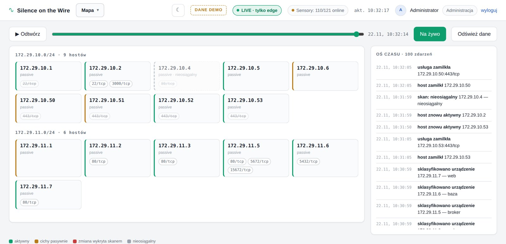
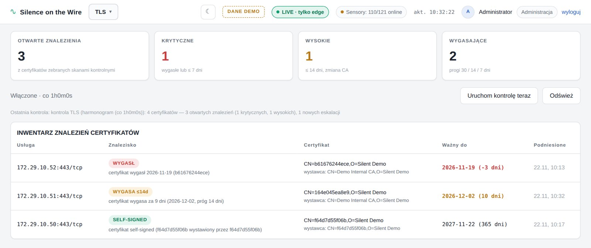

<!-- _class: title -->
<!-- _paginate: false -->

# Silence on the Wire

Pasywny sensor, który budzi aktywny skaner

**Attack Surface Intelligence** · HackNation 2026 · zamawiający: CBI AGH

Demo na żywo: silent.zjadlabymciastko.net

<!--
Narzędzie do ciągłego discovery dużej sieci. Nazwa pochodzi od książki Michała Zalewskiego o rekonesansie pasywnym.
Plan: problem, pomysł, architektura, demo, a potem skaner, zmiany w czasie, bezpieczeństwo i role, rynek, podsumowanie.
-->

---

## Problem

- Duże sieci (**ponad 10 000 adresów**) skanuje się okresowo: między skanami zespół jest ślepy
- Host może odpowiadać tylko o określonej porze: jednorazowy skan nie daje pełnego obrazu
- Same otwarte porty to za mało: ważne, **co** tam działa (panel admina, staging, CMS, stary komponent) i **co robić najpierw**
- Pytania z zadania:
  - jak raportować zmianę?
  - jak ocenić pewność wyniku?
  - kiedy uznać host za nieaktywny?

<!--
Pełny skan całej sieci jest drogi i hałaśliwy, więc nikt nie robi go ciągle. Brakuje narzędzia, które to łączy z DefectDojo.
Na trzy pytania odpowiadamy konkretnie na slajdach 6 i 7.
-->

---

## Teza: słuchaj ruchu, skanuj tylko tam, gdzie coś się zmieniło

  
<b>Sensor</b>pasywny, libpcap + BPF
➜
  
<b>Edgegate</b>opcjonalny scoring AI
➜
  
<b>Trigger</b>debounce, cooldown, limity
➜
  
<b>Skan celowany</b>nmap + HTTP + sygnatury
➜
  
<b>Konsola / eksport</b>diff, ryzyko, CSV, DefectDojo (CLI)

- Sensor widzi ruch ciągle: nowy host, nowa usługa, zmieniony baner, usługa zamilkła
- Trigger zamienia zdarzenia na **celowane skany**, z limitami; wynik wraca jako sprawa z werdyktem
- Ten sam pipeline obsługuje klasyczny skan okresowy (`scanner`, `scanner schedule`)

<!--
Pasywny sensor niczego nie wysyła do sieci, więc jest bezpieczny i tani. Aktywny skan włączamy po sygnale,
a jego intensywność ogranicza polityka.
-->

---

## Architektura

- **sensor**: Go, libpcap, filtr BPF w jądrze, baseline hostów, usług i banerów
- **trigger**: debounce, cooldown, quiet, limit tempa, allowlista
- **pipeline**: `nmap -sT -sV` + prober GET + **38 sygnatur** YAML + CVE/EPSS
- **harmonogram**: okna czasowe, częstotliwość, wznawianie, adaptacyjne paczki

- **konsola**: Alerty, Mapa, Ekspozycja, TLS, Zasoby, Ryzyko, Cele i import, Role
- **eksport**: CSV, JSON, nmap XML, **DefectDojo**
- **edgegate**: kaskada modeli (na demo wyłączona)
- **wdrożenie**: kontenery bez uprawnień, demo za Cloudflare Tunnel

Komponenty to osobne binarki połączone webhookami JSON · sensor tylko z <code>CAP_NET_RAW</code>

<!--
Bramka AI jest opcjonalna. Publiczne demo: jedna VM, konsola za Cloudflare Tunnel (Access wyłączony na czas oceny), lab AGH z sensorem i triggerem
na tej samej maszynie, aktualizacja obrazów co 5 minut.
-->

---

## Demo na żywo

1. `silent.zjadlabymciastko.net`: konto `jury` (odczyt) i `admin` (import skanu, diff, edycja)
2. **Mapa** z suwakiem czasu i **TLS** (wygasłe i samopodpisane certyfikaty); **Ryzyko**: ranking 0–100
3. Terminal: `scanner diff` (`+ 18787/tcp http nginx 1.31.9`), `export -format defectdojo -dry-run`

  <figure><figcaption>Mapa: topologia labu i oś czasu zdarzeń</figcaption></figure>
  <figure><figcaption>TLS: znaleziska certyfikatów z kontroli skanami</figcaption></figure>

Scenariusz: docs/DEMO.md · dane flotowe (137 sensorów) są syntetyczne, Mapa, TLS i Zasoby pochodzą z żywego labu AGH

<!--
Pokaż rozgraniczenie ról na żywo: ten sam ekran, dwa konta. Flota 137 sensorów, sprawy i część rankingu to dane syntetyczne trybu demo;
Mapę, TLS i Zasoby napełniają prawdziwe zdarzenia i skany labu AGH. Skan 7 portów labu trwa 5 s (zwykłe nmap -sV: 48 s, zmierzone). Jeśli sieć zawiedzie,
wyniki z terminala są w DEMO.md.
-->

---

## Skaner i fingerprinting

<b>38</b>sygnatur wbudowanych

<b>0,99</b>pewność Gitea

<b>0,95</b>pewność RabbitMQ

<b>5 s</b>skan labu AGH (nmap -sV: 48 s)

- IP, CIDR (do /12), nazwy; paczki dobierane do zmierzonego tempa (`-chunk-time`), 4 równoległe procesy nmap
- Prober **tylko GET**: status, tytuł, nagłówki, ciasteczka, certyfikat TLS, przekierowania, favicon (mmh3 jak Shodan)
- **Pewność** = noisy-OR wag dowodów: `1 − Π(1 − w)`, próg 0,5
- Obserwacje: panel admina, staging, strona domyślna, instalator, certyfikat samopodpisany; CVE z EPSS i KEV

<!--
Sygnatury wykrywają obecność, nigdy nie próbują logowania ani eksploatacji. Kilka niezależnych słabych dowodów daje wysoką pewność,
pojedynczy słaby zostaje niski. Zapytanie CVE idzie do NVD i FIRST, nie do hosta, i tylko gdy znamy wersję produktu.
-->

---

## Zmiany w czasie i hosty niestabilne

- **Diff** dwóch skanów: nowe `+`, znikające `-`, zmienione `~`; host spoza celów to „nie skanowany”, nie „zniknął”
- **Kiedy host nieaktywny?** Trzy stopnie:
  1. sensor: cisza dłuższa niż `-silent-after` (domyślnie 2 min) → `host_silent`
  2. trigger weryfikuje aktywnie: `still-up` albo `down-confirmed`
  3. po „żyje” 30 min ignorowania kolejnych „zamilkł”, cooldown 60 s
- Host niestabilny (flapper 60 s up / 60 s down): każda zmiana = celowany skan
- Mapa odtwarza dziennik zmian suwakiem; monitor TLS: wygasanie 30/14/7 dni, zmiana CA
- Harmonogram: okna `-window`, `-every`, wznawianie po zamknięciu okna

<!--
Pojedyncza brakująca odpowiedź to nie dowód. Rozdzielamy podejrzenie od potwierdzenia. Uczciwie: w trybie okresowym scanner diff
oznacza zniknięcie po jednym skanie; reguły „N skanów z rzędu” i analizy „ta sama pora, różne dni” nie mamy.
-->

---

## Bezpieczeństwo, RBAC i szyfrowanie

**Skaner**
- tylko GET, bez logowania i exploitów, bez NSE
- allowlista, `-max-rate` 300 pkt/s, 10 skanów/min
- kontenery bez uprawnień

**Konto**
- PBKDF2-SHA256 (120 000 iteracji)
- samorejestracja wyłączona
- demo tylko przez Cloudflare Tunnel

**RBAC** (22 uprawnienia)
- `admin`: administracja
- `editor`: dodawanie, usuwanie, modyfikacja
- `analyst`: modyfikacja i odczyt
- `viewer`: odczyt
- własne role, audyt zmian

**Szyfrowanie w spoczynku**
- **AES-256-GCM**: konta, role, sprawy, inwentarz, TLS, audyt

Luki: pliki wyjściowe CLI (scan.json, findings.jsonl) nieszyfrowane · harmonogram i uruchamianie skanu poza UI konsoli

<!--
Pokaż, że jury dostaje 403 na zapisie, mimo że przycisk „Edytuj” jest widoczny (serwer jest źródłem prawdy).
Szyfrowanie sprawdzone: pliki zaczynają się od nagłówka ASIE. Powiedz wprost o lukach.
-->

---

## Rynek i porównanie

| | nmap | SecureCodeBox | Wappalyzer / nuclei | **Silence on the Wire** |
|---|---|---|---|---|
| Skan aktywny | tak | orkiestracja | nuclei: własne żądania | nmap + GET, bezpieczny |
| Pasywny sensor i zdarzenia | nie | nie | nie | **tak** |
| Diff między skanami | ndiff | zależnie od skanera | nie | **tak**, wbudowany |
| Własne sygnatury bez eksploatacji | NSE | szablony | tak | **tak**, tylko GET + importer |
| DefectDojo | import XML | tak | nuclei: import JSON | **tak**, finding informacyjny |
| Role, szyfrowanie, ranking ryzyka w jednej konsoli | nie | RBAC Kubernetesa | nie | **tak** |

Kolumny cudzych narzędzi to ogólna ocena z dokumentacji, nie pomiar.

<!--
Treść zadania wymienia SecureCodeBox jako podobny projekt, który nie spełnia w pełni wymagań. Nasz wkład to pętla
pasywny sensor → celowany skan → konsola z rolami. Sprawdź kolumny cudzych narzędzi przed prezentacją.
-->

---

## Podsumowanie

**Działa:** discovery i usługi · fingerprinting z pewnością · diff · sensor + trigger · eksport CSV/JSON/nmap/**DefectDojo** · harmonogram (CLI) · CVE/EPSS · konsola z **RBAC** i **szyfrowaniem** · import i edycja · mapa, TLS, zasoby, ranking ryzyka · publiczne demo

<b>Luki (uczciwie):</b> harmonogram i skan celów poza UI · Shodan/Censys bez kluczy · bramka AI wyłączona na demo · brak reguły „N skanów z rzędu” i analizy pory dnia · skala: 16 384 adresy w 34 s, tylko na pętli zwrotnej · wyniki w plikach, nie w bazie

**Dalej:** skan z konsoli, baza z szyfrowaniem, pomiar w sieci 10 000+ adresów, wdrożenie w CBI AGH

<!--
Zamknij tym, co faktycznie jest, i tym, co w drodze. Zaproś do rozmowy o wdrożeniu w CBI AGH i współpracy z innymi uczelniami.
-->
