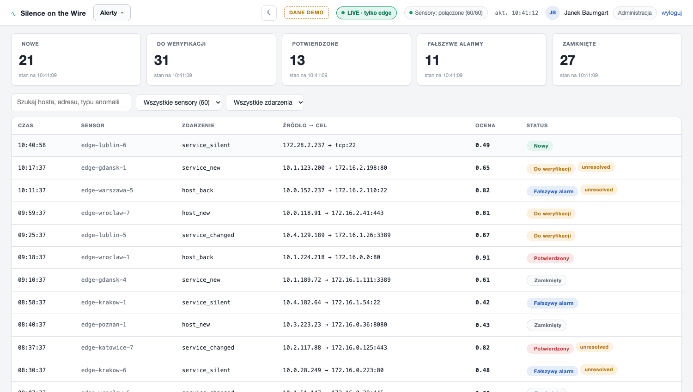
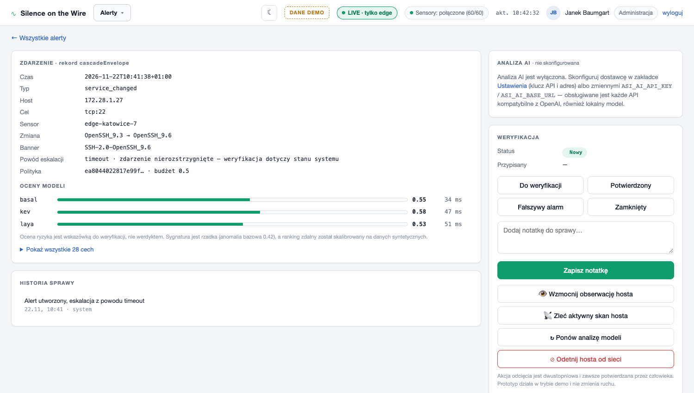
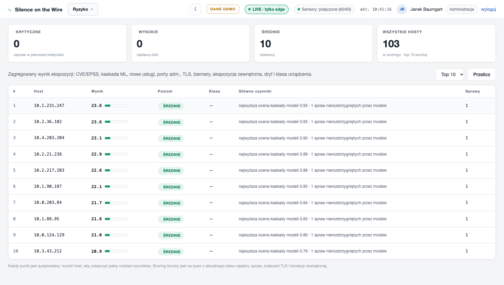
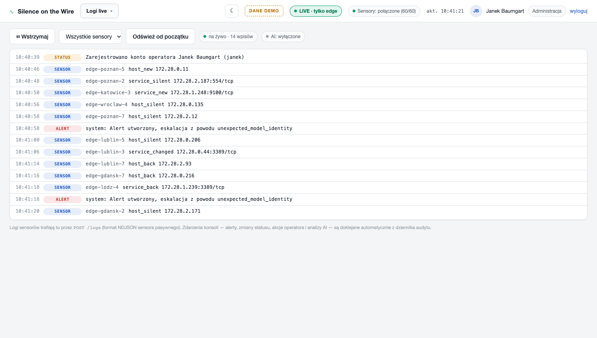

<!-- _class: title -->
<!-- _paginate: false -->

# Silence on the Wire

Pasywny sensor, który budzi aktywny skaner

**Attack Surface Intelligence** · HackNation 2026 · zamawiający: CBI AGH

Przegląd platformy: moduły, demo, roadmapa · appendix do decku głównego · demo: silent.zjadlabymciastko.net

<!--
Appendix do decku głównego (deck.md, 10 slajdów wymaganych przez treść zadania): pełny przegląd
platformy moduł po module, screenshoty z konsoli, konta demo i roadmapa — materiał na pytania jury.
-->

---

## Problem i teza

### Problem

- Duże sieci (**10 000+ adresów**) skanuje się okresowo — między skanami zespół jest ślepy
- Host może odpowiadać tylko o określonej porze
- Same porty to za mało: liczy się, **co** tam działa i **co naprawić najpierw**

### Teza

**Słuchaj ruchu cały czas, skanuj aktywnie tylko tam, gdzie coś się zmieniło.**

- sensor pasywny = tanio i bezpiecznie, 24/7
- skan aktywny = celowany, z limitami, na żądanie zdarzenia
- konsola = jedna powierzchnia decyzyjna dla operatora

---

## Przepływ danych

  
<b>Sensor</b>libpcap + BPF, baseline
➜
  
<b>Edgegate</b>opcjonalny scoring AI
➜
  
<b>Trigger</b>polityka, limity
➜
  
<b>Pipeline</b>nmap + prober + sygnatury + CVE
➜
  
<b>Konsola</b>sprawy, ryzyko, akcje

- **3 tryby tego samego potoku**: ręczny (`scanner`), harmonogram (`scanner schedule`), zdarzeniowy (sensor → trigger)
- Wszystko ląduje w **konsoli operatora**: `POST /logs` (sensor), `/findings` (trigger), `/events` (bramka AI), import plików
- Osobne binarki połączone webhookami JSON z tokenem — każdy moduł da się wymienić lub wyłączyć

---

## Mapa modułów

| Warstwa | Moduły | Rola w jednym zdaniu |
|---|---|---|
| **Obserwacja** | sensor, traffic (lab) | widzi ruch i zgłasza zmiany; generator ruchu do testów |
| **Decyzja edge** | edgegate (basal, laya, kev) | kaskada modeli ML ocenia zdarzenia przed skanem |
| **Egzekucja** | trigger, scanner, schedule | zamienia zdarzenia w celowane, bezpieczne skany |
| **Wiedza** | probe, fingerprint, sigimport, vuln, diff, result, export | co tam działa, jakie CVE, co się zmieniło, eksport |
| **Konsola** | console + 14 pakietów wewn. | sprawy, mapa, ekspozycja, TLS, zasoby, ryzyko, reguły, AI operator, RBAC, audyt, szyfrowanie |

Go 1.26 · Python (modele ML) · ~20 pakietów w <code>internal/</code> · pokrycie testami publikowane jako badge z CI

---

## Moduł: Sensor — oczy platformy

**Co robi:** przechwytuje pakiety (libpcap, filtr BPF w jądrze: ARP, SYN/RST, nagłówki HTTP), buduje trwały **baseline hostów, usług i banerów** i emituje zdarzenia JSON-lines / webhook.

| Zdarzenie | Znaczenie |
|---|---|
| `host_new`, `service_new` | coś się pojawiło |
| `service_changed` | zmienił się odcisk banera HTTP |
| `service_closed` | RST: host żyje, port zamknięty |
| `host_silent`, `service_silent` | cisza dłużej niż `-silent-after` (2 min) |
| `host_back`, `service_back` | powrót po ciszy/zamknięciu |

Tylko <code>CAP_NET_RAW</code> · wykluczenia własnej infrastruktury (<code>-exclude-net</code>, globs interfejsów) · TTL+checkpoint historii hostów (skala 10k IP) · replay z pcap do testów

---

## Moduł: Edgegate — kaskada AI na krawędzi

**Co robi:** opcjonalna bramka między sensorem a triggerem. Kaskada **Tree+GNB → Basal + Laya + Kev** ocenia każde zdarzenie i przekazuje dalej z polem `score`; zdarzenia o ciszy/zamknięciu przechodzą zawsze.

- **Standard wymienności:** modele wystawiają wspólny interfejs HTTP (`/v1/systemone`) — wraz z rozwojem AI przepinamy się na nowsze, mniejsze, tańsze energetycznie modele bez zmian w reszcie systemu
- Wagi (~2,5 GB) pobierane z przypiętych rewizji i weryfikowane **SHA256** — nie leżą w repo
- Może działać na **zewnętrznym kontenerze**, gdy endpoint nie udźwignie modeli

Cel 50% odfiltrowania skalibrowany na danych syntetycznych — to nie twarda kwota. W demo online bramka wyłączona.

---

## Moduł: Trigger — bezpiecznik aktywnej strony

**Co robi:** zamienia zdarzenia w **celowane zlecenia skanu** przez ten sam pipeline; wynik jako *finding* z werdyktem i diffem względem poprzedniego skanu celu, wysyłany do konsoli.

**Polityka (czysta, testowalna):**

- allowlista **wymagana**, ignorowanie własnych adresów
- debounce 5 s, quiet 15 s, cooldown 60 s / 5 min
- limit 10 skanów/min, 1000 zleceń, 2 równolegle

**Werdykty findingów:**

`scanned` · `still-open` · `gone-confirmed` · `still-up` · `down-confirmed` · `error`

Histereza: po „żyje" ignoruje „zamilkł" przez 30 min — skan sam budzi hosta.

<code>GET /healthz</code> pokazuje kolejkę i powody odrzuceń · <code>-findings-url</code> wysyła findingi do konsoli z tokenem

---

## Moduł: Skaner i harmonogram

### Skaner (`cmd/scanner`)

- cele: IP, CIDR do /12, domeny; pliki TXT
- paczki **adaptacyjne** (`-chunk-time`) po równoległe procesy nmap
- bezpieczny profil: `-sT` connect, `-sV`, limit 300 pkt/s, **bez NSE i OS detection**
- `scanner diff`: `+` nowe, `-` znikające, `~` zmienione

### Harmonogram (`scanner schedule`)

- okna czasowe (`-window`), częstotliwość (`-every`), strefa (`-tz`)
- zamknięcie okna zatrzymuje nmap, kolejne okno **kontynuuje** od checkpointu
- paczki liczone tak, by zdążyć przed końcem okna

Wynik = jeden dokument JSON z ustawieniami i czasami paczek — skan jest odtwarzalny.

---

## Moduł: Prober, sygnatury i importer

**Prober (`internal/probe`):** wyłącznie GET — status, tytuł, nagłówki, ciasteczka, przekierowania w obrębie hosta, **certyfikat TLS**, favicon (hash **mmh3 zgodny z Shodan**).

**Sygnatury (`internal/fingerprint`):** własny format YAML, jeden rodzaj dowodu na matcher, wagi → **noisy-OR confidence**. 38 wbudowanych (CMS, panele, bazy, IoT, staging, admin-panel…).

**Importer (`cmd/sigimport`):** tłumaczy Wappalyzer i szablony nuclei (w tym hashe favicon) na nasz YAML → **~60 000 sygnatur** bez adopcji ich silników. Generowany plik to dane — przerabia się go z nowych źródeł.

Favicon: admin ukryje Server, wersję i tytuł — stockowej ikonki prawie nikt nie podmienia.

---

## Moduł: CVE / EPSS / KEV

**Co robi:** wykrytą wersję produktu tłumaczy na **CPE**, pyta **NVD** o CVE i szereguje je wg prawdopodobieństwa eksploatacji **EPSS** (FIRST), oznaczając listę **CISA KEV**.

- Każda technologia w wyniku: do 5 pozycji `CVE-… — CVSS, EPSS, KEV`
- Bez wersji **celowo nie pytamy** — odpytanie bez wersji to szum, nie wywiad
- Fail-soft: brak sieci = brak wzbogacenia; cache na dysku (NVD 7 dni, EPSS/KEV 24 h)
- `NVD_API_KEY` podnosi anonimowy limit ~10×

Zmienia listę zmian w <strong>ranking realnego ryzyka</strong> — serce attack surface intelligence.

---

## Moduł: Diff i eksport

- **Diff (`internal/diff`):** nowe / znikające / zmienione hosty i usługi; pomija dane zmienne z natury (daty, ETag); host spoza celów nowego skanu to „nie skanowany", nie „zniknął"; ostrzega przy różnicy argumentów nmap
- **Eksport (`scanner export`):** CSV, JSON, nmap XML i **DefectDojo** — obserwacje (panel admina, staging, self-signed, przeterminowane komponenty) jako findingi informacyjne ze stabilnym `unique_id_from_tool` (kolejne przebiegi odświeżają dowody, nie ruszają decyzji analityka)
- Selektory: `-select default,category:database,tech:Gitea,tag:login`, `-min-confidence`

---

## Konsola operatora — jedna powierzchnia decyzyjna

| Zakładka | Co daje |
|---|---|
| **Alerty** | sprawy z licznikami, statusy, notatki, **akcje** (skan, odcięcie z potwierdzeniem) |
| **Mapa** | topologia sieci z **suwakiem czasu** — widać dryf powierzchni |
| **Ekspozycja** | diff „wnętrze vs internet" (Shodan/Censys) — shadow IT |
| **TLS** | wygasanie 30/14/7 dni, self-signed, zmiana CA, słaba kryptografia |
| **Zasoby** | żywy CMDB z ruchu: 16 klas urządzeń (kamera, drukarka, IoT…) |
| **Ryzyko** | ranking hostów 0–100 z jawnym rozbiciem na czynniki |
| **Logi live / Sensory** | strumień zdarzeń na żywo, flota i jej kondycja |
| **Cele i import** | formularz + import TXT/CSV/JSON z diffem, nadpisania przeżywają skany |
| **Reguły / Ustawienia / Role** | tryb deterministyczny, AI operator, RBAC |

---

## Alerty — triage spraw na żywo

---

## Sprawa: oceny kaskady ML i audytowane akcje

---

## Ranking ryzyka i logi na żywo

---

## Konsola: bezpieczeństwo samej platformy

### RBAC i audyt

- **22 uprawnienia**, role wbudowane: `admin`, `editor`, `analyst`, `viewer` + role własne
- PBKDF2 (120k iteracji), sesje 12 h, `HttpOnly`+`SameSite=Lax`
- samorejestracja do wyłączenia (`ASI_ALLOW_REGISTRATION=false`)
- każda zmiana sprawy/roli/konta w **dzienniku audytu**

### Szyfrowanie w spoczynku

- **AES-256-GCM**, nagłówek `ASIE\x01`, nazwa pliku jako AAD
- szyfrowane: konta, role, ustawienia (z kluczami API), sprawy, inwentarz, TLS, ekspozycja, audyt
- klucz z env/pliku/pierwszego startu (0600); utrata klucza = nieczytelne dane

---

## Konsola: AI operator i tryb reguł

### AI operator (LLM)

- analiza logów z endpointów przez **dowolne API zgodne z OpenAI** — ChatGPT, ale też model lokalny; klucz w ustawieniach konta (`ASI_AI_API_KEY`)
- orkiestruje pracą platformy: ocenia ruch, zmienia statusy spraw, **uzbraja** akcje
- **odcięcie hosta zawsze potwierdza człowiek** — pełny audyt decyzji AI

### Tryb reguł (fallback)

- gdy modele decyzyjne (Bayes, drzewa, basal/kev…) są zbyt wolne: przełącznik na **sztywne reguły** definiowane w dashboardzie
- reguły startowe w repo; triage deterministyczne bez ML

Tryb demo z syntetyczną flotą ↔ przełącznik na prawdziwe logi z sensorów edge — jeden przycisk.

---

## Moduł: Ground truth — kontrola ślepego scenariusza

**Problem:** host, który nigdy nic nie wysyła (`silent_stealth`), jest pasywnie nierozróżnialny od wyłączonego.

**Rozwiązanie:** co 6 h konsola sonduje próbkę (50) hostów milczących ≥ 60 min łączeniami TCP na znanych portach.

- werdykt **„zweryfikowany cichy"** vs **„ZMIANA w ciszy"** trafia na mapę i do spraw
- luka obserwowalności jest **mierzona**, nie niewidoczna

Ustawienia w dashboardzie: interwał, próg ciszy, wielkość próbki.

---

## Bezpieczeństwo działania (defensywność)

- Skaner i prober **tylko odczyt**: GET bez logowania, przekierowania w obrębie hosta, limity rozmiaru i czasu
- Limity tempa wszędzie: `-max-rate`, `-parallel`, cooldowny, quiet window, cap kolejki
- Allowlista celów wymagana w triggerze; CIDR max /12
- Kontenery **bez uprawnień** (`cap_drop: ALL`; sensor tylko `CAP_NET_RAW`)
- Webhooki z tokenem bearer; bez tokena 401
- Zapytania CVE/EPSS idą do NVD/FIRST — **nigdy** do skanowanych hostów

---

## Wdrożenie i CI

- **5 obrazów** (sensor, scanner, trigger, traffic, console) z CI na ghcr.io, amd64+arm64, tagi `latest`/`sha`/`semver`
- Testy z pokryciem + badge; budowanie obrazów także na PR
- **Demo publiczne**: jedna VM, konsola za **Cloudflare Tunnel + Access** (PIN na e-mail), zero publikowanych portów, aktualizacja obrazów co 5 min
- **Stack cascade50**: konsola + edgegate + modele ML (basal/laya/kev) + central — compose
- **Lab CBI AGH**: nakładka dodaje sensor, trigger, traffic i hosta „flapper" bez ruszania ich szablonów

---

## Konta do publicznego demo

| Login | Rola | Co wolno |
|---|---|---|
| `jury` | viewer | pełny podgląd wszystkich zakładek, zero zapisu — niczego nie da się zepsuć |
| `jury-analyst` | analyst | podgląd + triage spraw: statusy, notatki, nadpisania |
| `admin` | administracja | **pokażemy w finale** 😄 |

Wejście przez Cloudflare Access (jednorazowy PIN na e-mail) · hasła kont w secrets na VM, nie w repo · samorejestracja wyłączona

---

## Roadmapa

### Krótki termin

- harmonogram i przycisk skanu w UI konsoli
- eksport CSV/JSON/DefectDojo z poziomu sprawy
- pomiar skali 10k+ i strojenie paczek
- menu nawigacji jako dropdown (PR #31), fix obrazu konsoli cascade50 (PR #33)

### Średni termin

- prawdziwe wykonanie odcięcia hosta (integracja z firewall/SDN, dziś audytowana decyzja)
- konto usługowe i SSO/OIDC
- baza SQL dla wyników zamiast plików

### Długi termin

- **federacja sensorów** — setki edge'ów, hierarchiczne agregowanie
- akcje SOAR: playbooki (odciecie → monitoring → przywrócenie) z audytem
- nowe klasy modeli edge przez standardowy interfejs — mniejsze, tańsze energetycznie
- korelacja „pora dnia × dzień tygodnia" dla hostów okresowych
- edytor sygnatur i marketplace reguł w UI

---

<!-- _class: title -->
<!-- _paginate: false -->

# Podsumowanie

Sensor słucha. Trigger decyduje. Skaner sprawdza. Konsola daje operatorowi pełny obraz i audytowane akcje.

**repo:** github.com/Inner-Savages/silence-on-the-wire · **demo:** silent.zjadlabymciastko.net
